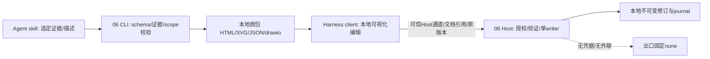

# 06 本地架构图生成、查看与独立编辑：软件设计

版本：DIA-DESIGN-2；日期：2026-11-07；状态：**设计已实现（组件级自测），真实 Host 安装/浏览器旅程未验证**；独立评审状态见[评审报告](references/design-review-surfaces.md)。本文冻结可编码接口；实际实现、来源采用方式、偏差与验收证据见[实现路线](implementation-route.md)、[接口合同](interfaces.md)、[兼容矩阵](compatibility.md)、[机制说明](mechanisms.md)。

| 修订 | 来源/变更 | 影响ID/验证状态 |
|---|---|---|
| DIA-DESIGN-1 | 2026-11-06用户确认首版生成/讲解和本地可视化编辑都要；默认自有受限编辑器，Drawio增强可选 | DIA-01—10；设计文本自检，功能/Host/出口未验证 |
| DIA-DESIGN-2 / 2026-11-07（现行） | 独立评审SR-01/03：完整overlay/命令/XML往返、真实RPC与owner/文档许可分离；产品选择见[产品说明](product-form.md) | DIA-06—10；新增DIA-RPC-01/DIA-OVERLAY-01；仅设计修订，功能/Host/出口未验证 |

## 1. 产品形态与首版使用

最终产品有两个可独立启用的入口，首版必须都交付：Agent根据用户选定的证据/描述生成和解释本地图；用户在本地可视化编辑器中拖拽、增删说明并保存 `.drawio`。用户可单独使用任一入口，安装依赖按所选实现最小化。图是可追溯的解释产物，不是代码调用关系数据库；手画边始终为annotation。

既有依据：skill+plugin分工、本地至少一种查看模式、优先现有Atlas离线HTML、生成与编辑分离、手改不回写编译事实、禁止公共图服务/远程字体图片/AI/云导出。高层产品项DIA-PF-01已由用户在本轮集中明确回复：图生成/讲解＋本地可视化编辑首版都要。T4/T5及编辑全旅程是首版退出条件；可以分阶段完成，生成组件通过不能冒充06完整交付。内部布局、XML细节、hash算法由开发决定，不重复询问。

首版旅程：

1. 用户在对话里说“把这条路径/这组模块画出来”，或在08工作台打开“图示”。Agent选择已登记的snapshot证据子集，说明哪些关系是exact/may/unresolved；一般概念图可从明确描述生成，标`conceptual`，不假装来自Atlas。
2. 若选定Atlas产物已有可用离线图，直接经资源校验后打开，不重复生成；需要聚焦/讲解布局时生成本地图包。缺Atlas或04未完成时，可使用明确概念输入和合成fixture，不等待04；没有证据的代码边保持annotation/unknown。
3. 用户打开本地HTML，看到图、来源/版本栏、置信图例、未解析/预算截断提示和文字等价列表。点节点/边查看获准的来源定位；越根/旧版本链接不能自动读文件。
4. 用户可保存独立HTML/SVG和图包manifest，并把生成的`.drawio`打开到本地可视化编辑器。某组件未就绪时明确阻断，不提供假保存按钮，首版仍标未完成。
5. 用户打开`.drawio`取得正文及同一版本token，在独立注释层拖拽、修改并保存，保存时带原token。外部改动冲突时保留双方，可重新打开或显式合并；不后台换最新token强行保存旧内容。

首版包含人工注释、布局拖拽、编辑器本地预览和版本保存。后续可扩展多页图、复杂形状和注释自动重排。首版不做公共分享链接、托管图存储、URL导入、从图反编译代码、改编译事实、云盘同步、实时多人协作、无限仓库扫描、自动下载图标模板或通用HTML/XML渲染。模型排版可选，确定性渲染不需要第二个模型服务。

## 2. 实施路线和固定来源

路线：证据→规范DiagramSpec→离线可访问HTML/SVG→`.drawio`转换→独立编辑plugin和保存守卫。首个可验组件是一个含exact、may、unresolved和手工边的合成图包，断网可查看、来源可回溯、换snapshot标stale、恶意标签不执行；随后必须完成本地拖拽编辑和保存再验收首版。

| 来源及固定身份 | 借鉴/采用机制 | 分类与限制 |
|---|---|---|
| 本机 `H:/VSCODE_READER`，调研自述SDK Code Atlas v0.8、MIT | snapshot身份、exact/may/unresolved、离线Viewer与已有边/源码证据 | 优先复用其已有产物；不复制/重写语义分析。当前仅调查版本，未锁全仓内容摘要/工作树状态，实施T1必须生成实际本地manifest；未运行doctor/索引，不把历史证据算当前可用 |
| [Archify](https://github.com/tt-a1i/archify/tree/a4065941f12be7967436261d9934784e381d423c) 3.2.0，固定树 `a4065941f12be7967436261d9934784e381d423c`，Apache-2.0 | Agent讲解图的布局/可视约束、DSH opt-in skill；禁更新变量 | 可选薄适配，当前无源码合入；实施前锁选定执行文件/资源/许可。`ARCHIFY_UPDATE_CHECK_DISABLED=1`只是一条防线，不是无外发证明 |
| [dsh-drawioedit](https://github.com/zhang-guo-wen/dsh-drawioedit/tree/bfbcf347f26d9158f7f34bbb6ce416e504b74cdd) 1.3.0，包`@guowenzhang/dsh-drawioedit`，固定树 `bfbcf347f26d9158f7f34bbb6ce416e504b74cdd`，Apache-2.0 | 本地编辑器、已有禁云SDK配置、save版本守卫思路 | 可选编辑层薄适配；不是事实分析器。上游无token路径不能原样采用；构件/vendor editor版本、依赖许可证、rc.5兼容与完整资源出口待核 |
| 本机Harness 0.2.1-rc.5，Node24.21.0/Electron44.7.0；asar SHA `e1b6f25fa937da98086c3e77af77aa14791105963c4d337a1c42179d232c6915` | client main panel、资源/Host鉴权、Cordis生命周期 | 使用已有Host，薄适配不升级；本地图生成CLI无Host依赖。05安装库证据不是06完整UI/出口验收 |

自有实现：严格证据适配、确定性SVG/HTML renderer、manifest/stale标记、受限mxGraph XML转换、安全保存和编辑桥接。Archify若无法离线审计或与证据标签冲突，采用自有renderer。Drawio若无可兼容rc.5构件，确定替代是自有受限SVG可视化编辑器（选择/拖拽节点、改文字、增删annotation边、删除注释、undo/redo、按同一版本合同保存），导出同受限`.drawio`子集；不远程嵌入app.diagrams.net。两种实现都必须完成首版编辑验收，不能用只读产物代替。

为消除候选准备对首版的阻塞，编码默认采用自有SVG编辑器；通过审计的Drawio只作为兼容增强，替换时保持同一document/save合同。进程/信任边界如下：



`source-lock.json` v1：`schema_version, runtime, host?, sources:[{id,kind,repository?,commit?,version,package?,artifact_sha256,license,license_ref,adopted_files[],resource_manifest_ref}], commands:[{id,executable_ref,args_template,env_fixed}], evidence_refs[]`。Atlas本机身份记录文件摘要和dirty摘要，不伪造commit；Archify/Drawio树哈希是调查身份，运行时仍需要实际字节SHA/NOTICE/依赖闭包。未核许可证不进入交付。

## 3. 目录与责任分离

```text
skills/explain-local-diagram/SKILL.md    # 选范围/证据/讲解/停止；不写事实库
skills/explain-local-diagram/references/contracts.md
src/contracts.mjs                      # 严格DiagramSpec/Artifact/Save schema
src/evidence.mjs                       # Atlas证据→规范输入，保留certainty
src/source-state.mjs                   # 当前身份比较，current/stale/unknown
src/layout.mjs                         # 稳定分层和坐标，生成与编辑布局分开
src/render-svg.mjs                     # 自有SVG，所有文本escape
src/render-html.mjs                    # 本地包HTML、图例和等价文字表
src/assets.mjs                         # 校验资源清单和离线策略
src/archive.mjs                        # 图包输出、摘要、幂等与原子提交
src/drawio/xml.mjs                     # 受限mxGraphModel构造/解析
src/drawio/import.mjs                  # XML限制/降级与未知节点拒绝
src/editor/access.mjs                  # 文档引用→登记根/权限/身份
src/editor/document-store.mjs          # 打开基线、版本、锁与journal
src/editor/save.mjs                    # expectedVersion写入与冲突
src/editor/bridge.mjs                  # 同源/窗口/channel/消息schema
src/editor/model.mjs                   # 默认自有SVG编辑模型、命令/undo
plugin/index.ts                        # 首版编辑Host入口
plugin/client.tsx                      # local-diagrams面板，独立于08
ui/{DiagramViewer,DiagramEditor,ConflictView}.tsx
tools/{render,validate,editor-smoke,network-smoke}.mjs
tests/{evidence,render,assets,xml,save,bridge,paths}.test.mjs
tests/fixtures/{snapshot,malicious,conflicts}/
docs/{implementation-route,compatibility,mechanisms}.md
```

> 实现注：以上是设计期文件职责。实际实现为 `plugin/index.mjs`（Host 入口）、`plugin/client.js`（由 `ui/*.mjs` + 选定 `src/*.mjs` 经 `tools/build-client.mjs` 确定性内联生成的 rc.5 懒 CJS bundle）、`ui/*.mjs`（纯函数/模型，无 TSX 构建链）、`src/editor/document-store.mjs` 合并原 save 职责；另有 `src/events.mjs`（03 事件消费）、`src/source-identity.mjs`（不透明 root 引用）、`src/plugin/service.mjs`、`tools/{build-client,registry,record-evidence}.mjs`。偏差与理由见[兼容矩阵](compatibility.md)。

`render`和skill可以独立使用，无Host凭据和会话修改权限；编辑器plugin可单装，只打开用户选定的登记文档。08仅入口，不持有XML或替06保存。04是证据生产者，可用fixture/manifest合同独立开发；04尚未实现不阻塞06概念图和确定性renderer。

## 4. 数据schema：事实、推断与注释不混层

所有schema `additionalProperties:false`，ID为1—128字符，计数/坐标有限整数，禁止NaN/Infinity/负尺寸；时间UTC。字符串纯文本，不接受HTML/脚本/URL。以下是新定义的本模块合同，不宣称Atlas原生格式。

```ts
type SourceIdentityV1 = {
 source_id:string; scope_ref:string; snapshot_ref:string;
 repos:{repo_id:string; root_ref:string; revision:string|null;
   dirty_digest:string; build_variant:string; arch:string;
   compdb_digest:string|null; generated_headers_digest:string|null}[];
 evidence_manifest_digest:string;
};
type EvidenceRefV1 = { evidence_id:string; source_id:string;
 repo_id:string; path_ref:string; content_digest:string;
 line_start:number; line_end:number; kind:'compiler'|'source'|'runtime'|'user';
};
type DiagramSpecV1 = {
 schema_version:1; diagram_id:string; revision:number;
 mode:'evidence'|'conceptual'; title:string; scope_ref:string;
 sources:SourceIdentityV1[];
 nodes:{id:string; label:string; kind:'module'|'function'|'type'|'resource'|'note';
   origin:'evidence'|'annotation'; evidence_refs:EvidenceRefV1[];
   description:string|null}[];
 edges:{id:string; from:string; to:string;
   kind:'call'|'reference'|'data'|'ownership'|'control'|'annotation';
   certainty:'exact'|'may'|'unresolved'|'unknown';
   origin:'evidence'|'annotation'; label:string;
   evidence_refs:EvidenceRefV1[]; explanation:string|null}[];
 layout:{algorithm:'layered_v1'; direction:'LR'|'TB';
   positions:{node_id:string;x:number;y:number;width:number;height:number}[]};
 coverage:{complete:false; truncated:boolean; omitted_nodes:number;
   omitted_edges:number; unresolved_count:number; notes:string[]};
 source_state:'current'|'stale'|'unknown';
 generated_at:string; renderer_ref:string;
};
```

evidence模式每条origin=evidence的exact边必须有锁定证据，且certainty不得超过原来源级别。`reference`不能因连到函数就升级成`call`。unresolved边可指向显式unknown节点。conceptual模式sources可空，所有边origin=annotation、certainty=unknown，不制造编译事实。用户写“这里一定会调用”也不改变证据层。coverage.complete v1固定false：一张聚焦图不承诺全仓完整。

图形编辑只产生以下DIA-OVERLAY-01，base_spec始终不可变；手工删/改证据的显示仅写view overlay，不修改事实。`.drawio`自定义属性/source ID不是信任凭证，不能因导入就回写exact。

```ts
type PositionV1={x:number;y:number;width:number;height:number};
type OverlayItemV1 =
 {id:string;kind:'note';target_ref:string|null;text:string;position:PositionV1} |
 {id:string;kind:'annotation_node';label:string;description:string|null;position:PositionV1} |
 {id:string;kind:'annotation_edge';from:string;to:string;label:string;description:string|null} |
 {id:string;kind:'layout';target_ref:string;position:PositionV1} |
 {id:string;kind:'visibility';target_ref:string;hidden:boolean};
type AnnotationOverlayV1={schema_version:1;diagram_id:string;base_spec_digest:string;
 revision:number;items:OverlayItemV1[];
 orphaned_annotations:{item:OverlayItemV1;reason:'target_missing'|'endpoint_missing'}[];
 updated_at:string};
```

每个union成员additionalProperties=false且所有列出字段必填，null仅用于明确可空字段；id唯一，新增项用`ann:<uuid>`，不得与base节点/边碰撞。target_ref/from/to只接受当前document的base或overlay实体ID，不接受URL、路径、另一个diagram的ID。每个目标最多一个layout和一个visibility；annotation_edge端点必须是有效可见节点，永远origin=annotation/certainty=unknown、evidence_refs为空。位置x/y为-100000…100000整数，width/height为1…10000；label≤256、description/note≤4096。note target=null为自由注释；target不见后保留但进入orphaned，不自动重绑同名实体。

证据图的base节点/边不能物理删除，visibility隐藏要在图例显示“已隐藏证据N项”，仍计coverage。概念图中base.origin=annotation的节点可用删除命令写visibility隐藏，不重写base；原有base边若关联隐藏端点也只在view隐藏。新增annotation_node限conceptual模式；证据图的附加说明用note/callout，不伪造代码实体。重新生成只按稳定ID重挂原note/layout/visibility；丢失目标或端点的原项整体保留在orphaned_annotations，用户显式处理，不静默丢弃或升为exact。

实体ID优先Atlas稳定ID；若概念输入无ID，规范化label+用户范围生成局部ID，不称稳定代码实体。edgeID由`source/target/kind/evidence_ids`规范摘要决定，布局变化不换edgeID。相同label不合并不同repo实体。

`ArtifactManifestV1 {schema_version:1,artifact_id,diagram_id,spec_digest,source_digests,renderer_ref,created_at,files:[{relative_path,media_type,sha256,size}],network_mode:'offline',source_state}`。同包输出 `index.html,diagram.svg,diagram-spec.json,manifest.json,evidence.json,diagram.drawio,annotations.json`；空注释也写版本文件。HTML footer显示source_state/概念或证据模式/生成时间/renderer。PNG/PDF仅在已锁本地转换器可用时加，首版SVG/HTML及可编辑drawio足够，不能临时调用远程导出。

资源限额默认：500节点、1000边、label256字符、description4096、单包20MiB、XML解压后10MiB、XML深度64、属性数256/节点、mxCell最多10000。超图限制要求缩小范围或明确截断，边界值测试；这些是工程初值可调，不伪称用户性能要求。

## 5. 生成接口、布局和产物事务

```ts
toDiagram({source_identity,evidence_subset,conceptual_input?},policy)
 -> DiagramSpecV1|{status:'denied'|'invalid';code:string}
validateSource(spec,currentIdentities)
 -> {state:'current'|'stale'|'unknown';changed_refs:string[];reasons:string[]}
renderLocal({spec,output_ref,renderer:'builtin'|'atlas_existing'|'archify',
 expected_output_revision:number|null,operation_id:string},caller,signal)
 -> {status:'saved';artifact_ref:string;manifest_digest:string}|
    {status:'conflict'|'denied'|'cancelled'|'failed'|'outcome_unknown';code:string}
exportDrawio({spec,annotation_overlay?},policy) -> {xml:string;warnings:string[]}
```

`caller`从工具/Host可信边界注入，不能由Agent JSON自造grant；output_ref解析为登记本地目录，不接受任意路径/URL。路径真实身份、范围和写权限在读取/保存时各核一次。renderer选择顺序：已有Atlas HTML通过资源校验且满足范围→优先直接引用本地artifact；自有SVG renderer默认→可选Archify只在锁定本地执行器已通过相同验证时启用。没有Atlas时不跑全仓分析“补齐图”，而是明确要求证据子集或conceptual。

确定布局算法：输入节点按稳定ID排序；对有向边求SCC（Tarjan），SCC DAG按最长路层级分层；同层按上游重心两次稳定扫描，tie按ID；节点固定最小宽160/高64、label按字符折行，层间96/同层32工程初值；自环/回边使用独立折线路径；SCC内原ID顺序展开。最终坐标取整数，重复相同spec/renderer输出同一布局。超过上限先拒绝或按用户范围保留前N并标truncated，不能丢边还显示完整。

自有SVG只生成白名单`svg,g,rect,path,line,polyline,text,tspan,title,desc`与固定安全属性；所有label/text XML转义，不生成foreignObject、script、style URL、image、a href或on*。节点可点击由HTML层可信ID选择处理，而不是将输入变链接。HTML内联本地固定脚本只做pan/zoom/选中/查表，无fetch/WebSocket/eval/new Function；CSP为`default-src 'none'; img-src data:; style-src <固定hash>; script-src <固定hash>; connect-src 'none'; object-src 'none'; base-uri 'none'; form-action 'none'`，hash随构件锁生成。图本体不需要外部图片；不允许任意data:image SVG嵌入。

原子产物：按`operation_id`在输出根建立staging，生成/验证所有文件和manifest摘要→fsync→同卷rename到不可变artifact_id目录→更新本工具指针。重复operation同spec返回同artifact，不同spec拒绝；已有不同内容目录不覆盖。取消在提交前清本工具staging，提交后返回已保存并说明取消过晚；崩溃后检查journal/manifest，完整则归档为saved，半包仍staging不开放。无法确认rename/指针状态为outcome_unknown，核对manifest再恢复，不重跑可能有外部副作用的执行器。

Archify子进程若启用：固定绝对路径及参数数组，shell=false、windowsHide=true，只传允许环境及固定 `ARCHIFY_UPDATE_CHECK_DISABLED=1`；超时/取消终止本操作拥有的process tree，确认退出后清staging；未知子进程退出不标cancelled。不存在联网安装/自动修复路径。生成失败可明确改用builtin重新建一个operation，不能暗中切另一个模型服务或丢来源标签。

## 6. 版本、stale和跨模块关系

source_state=current只表示当前登记身份与spec引用一致，不表示代码关系已被运行验证。生成前/打开时/用户刷新时核snapshot、dirty、CONFIG/build variant、compdb和生成头摘要；缺当前身份返回unknown；任一差异stale并列差异，不能仅比文件名/commit。静态exact与runtime观察分开，旧source定位先显示原证据，不把旧行号跳到新代码后标已验证。

03事件按共同v1合同消费：session_surface_rewound不必直接让独立代码snapshot失效，但使来自被回退学习对话的注释来源待核；workspace_files_restored对相交repo使source_state=stale；session_removed清会话关联，不物理删独立artifact。事件outcome=partial/unknown保持stale/unknown，缺after_snapshot不可猜。去重event_id，跳号按本地登记身份重核，不等03全实现才可用fixture验证。

05不自动吸收图中注释为长期规则；若用户已启用受控记忆提炼，只给来源引用/图模式/版本，不把图看起来通顺当事实证据。07可观察生成工具输出但06不改上下文；08只导航。04可将artifact_ref写学习记录，不改变prediction/observation的待验证状态。

## 7. 独立编辑器：打开、消息协议和XML边界

默认自有编辑器以SVG呈现规范base+overlay，React层只输出白名单元素；不接收任意HTML/SVG。选择节点后可拖拽/键盘方向键移动（默认8px，Shift 1px）、编辑纯文本注释；从一个节点点“连接”再选目标新增annotation边，可删除annotation。base事实节点/边只允许布局/显示文字注释，不物理删除证据。触控/鼠标拖拽用Pointer Events、pointer capture并在pointerup提交一个命令，cancel不产生半条历史；提供表单坐标作为无需拖拽替代。

`EditorModelV1 {schema_version:1,base_spec_digest,overlay,selection:string[],draft_revision:number,dirty:boolean}`。接口DIA-API-EDIT：`createEditorModel(spec,overlay)`；`executeEdit(model,{command_id,expected_draft_revision,kind,payload}) → {model,inverse}|stale|invalid`。完整命令union如下，禁止在实现时另加未入schema的kind：

| kind | payload及限制 | overlay变化 |
|---|---|---|
| `move_node` | `{node_id,x,y}`；节点存在且未隐藏 | annotation_node更新position；base写/更新layout，沿用width/height |
| `set_note` | `{annotation_id,target_ref,text,position}` | 新建/更新同ID note；自由note允许target_ref=null |
| `add_annotation_node` | `{id,label,description,position}`；仅conceptual，ID无碰撞 | 新增annotation_node |
| `set_annotation_node` | `{id,label,description}`；仅已存在overlay节点 | 修改其纯文本，禁止改类型/证据 |
| `add_annotation_edge` | `{id,from,to,label,description}` | 校验端点后新增annotation_edge |
| `remove_annotation` | `{id}`；只可note/annotation_edge，不接受node/layout/visibility ID | 删除该项；逆操作保留原完整项 |
| `remove_annotation_node` | `{node_id}`；overlay节点或conceptual base annotation节点 | overlay节点移除，conceptual base节点写visibility；先移除该节点所有旧关联overlay边、note/layout/visibility，再为conceptual base节点写新的隐藏项；逆操作保存全部原项，base边只view隐藏 |
| `set_visibility` | `{target_ref,hidden}`；仅base实体 | 新建/更新唯一visibility；证据仍留base并显示隐藏计数 |
| `undo` / `redo` | `{}` | 原子应用上一复合patch或其反patch |

所有payload additionalProperties=false；ID/位置/尺寸/字符串沿DIA-OVERLAY-01约束。命令ID同digest去重，异内容冲突；成功推进draft_revision。`inverse`为仅内部使用的`{before_revision,after_revision,restore_items:OverlayItemV1[],remove_ids:string[],restore_selection:string[]}`，一次节点删除及关联项作为一条复合历史；逆patch不得从RPC任意提交。undo/redo都校验当前revision、实体约束和完整图；新编辑清redo，最多100条/2MiB，超出只淘汰最旧完整命令。保存交Host对照其自有canonical base检查overlay，再重新序列化XML，不信任client所声称的exact。

序列化往返确定为：`base DiagramSpec + overlay → validateComposite → XML/JSON不可变revision → open解析 → 同一base digest与overlay`。本工具XML使用root cells `0`及三个layer `layer-base/layer-annotations/layer-notes`；base与ann cell ID以`base:`/`overlay:`前缀编码，source/target经ID表映射。布局取overlay优先，annotation节点/边永远带`data_origin='annotation',data_certainty='unknown'`，不写伪造evidence；隐藏项仍在JSON，XML相应cell标受限visible属性，不丢原项。manifest同时锁`diagram-spec.json`、`annotations.json`和XML字节摘要，Host从自己的document store取canonical base/overlay，不依赖XML自报来源。

导入外部XML（含本工具曾导出的文件）默认按无可信证据的conceptual读入：几何/纯文本/端点映射到overlay annotation_node/edge，自有空conceptual base；其data_*元数据只可显示，不提升来源。只有从已登记且当前摘要匹配的**本工具document revision**打开时，才从Host存储加载原base＋overlay；前端save的XML需与该base逐实体对照，仅可表达白名单overlay命令，不可替换base。用户把文件复制改名或改XML后无法凭data_base_digest重新取回exact授权。外部格式未知高级形状继续unsupported，不删字段后强存。

T4/T5新增往返验收：空conceptual图加两节点一边、移动/注释→保存重开→删节点（关联边/note一并处理）→undo/redo→再保存重开；JSON union无额外字段，base摘要不变，关联项恢复完整，annotation保持unknown；外部XML假exact元数据仍降为conceptual。证据图隐藏/取消隐藏不改变base关系或coverage。

```ts
type DocumentVersionV1 = {schema_version:1; document_id:string;
 generation:number; content_sha256:string; byte_length:number;
 path_identity_digest:string};
openDocument({document_ref,expected_scope},caller)
 -> {status:'opened';document_id:string;xml:string;base_spec:DiagramSpecV1;
     overlay:AnnotationOverlayV1;version:DocumentVersionV1;
     editor_session_ref:string;channel_nonce:string;warnings:string[]}|
    {status:'denied'|'unsupported'|'unavailable';code:string}
saveDiagram({document_id,editor_session_ref,expected_version:DocumentVersionV1,
 xml:string,overlay:AnnotationOverlayV1,operation_id:string},caller,signal)
 -> {status:'saved';version:DocumentVersionV1}|
    {status:'conflict';current_version:DocumentVersionV1;draft_ref:string}|
    {status:'denied'|'invalid'|'cancelled'|'outcome_unknown';code:string}
```

open的xml/version在同一受控读取中得到：打开句柄→核身份/大小→读→fstat复核→hash→发版本；检测变化则重试一次，再变返回conflict。base/overlay/manifest与XML必须来自同一不可变revision，禁止先读XML再获取最新token补齐；外部导入只建立新的conceptual基线。编辑会话绑定caller+scope+document_id+generation，默认内存TTL一小时，撤权/停用即失效。

editor本地vendor文件单独origin/iframe或经Host受限资源服务；严禁远程editor URL。iframe只授必须的script能力，不授top navigation/popups/download/file访问；优先独立本地origin以支持严格校验，避免把同源+allow-same-origin+scripts当隔离。bridge检验 `event.origin===锁定editor origin`、`event.source===该iframe.contentWindow`、随机128bit channel_nonce和schema。nonce只内存握手，不写URL查询/log。若只能opaque sandbox origin，不能`origin='null'`一律放行：用创建iframe时转移的专属MessagePort绑定、source校验，后续只走port；这属于可行替代而非通配postMessage。

消息v1 `{schema_version:1,channel_nonce,message_id,editor_session_ref,type:'ready'|'load'|'draft_changed'|'save_request'|'save_result'|'cancel'|'error',payload}`。每类型严格schema/大小，未知type拒绝；保存请求仍须Host权限/版本检查。Bridge不转发任意JS、URL、文件路径和shell。重复message_id去重、save operation绑定确切XML及overlay摘要，第二次同ID不同正文拒绝。

输入XML禁止DOCTYPE/ENTITY、外部实体、XInclude/processing instructions。默认不依赖未选的第三方XML库：`xml.mjs`实现限长流式tokenizer+栈的严格子集解析，只读UTF-8、双/单引号属性、标准五种字符实体与合法Unicode数值实体；只允许开/闭/自闭元素及文本，不接受CDATA、namespace声明、PI、DTD、注释或重复属性。名称按ASCII允许集匹配、解码实体后再跑属性schema，先限字节/深度/节点数，解析结束要求空栈和唯一根。它明确是受限格式解析，不冒称完整XML兼容；高阶外部drawio返回unsupported。只接受未压缩`mxfile/diagram/mxGraphModel/root/mxCell/mxGeometry/mxPoint/Array`白名单及固定父子关系；首版压缩diagram内容拒绝，提示先本地导出未压缩XML，不默认解压zipbomb。属性白名单：id/value/style/parent/source/target/vertex/edge/visible/geometry基础字段及本工具namespace元数据（编码为普通data_*属性，不开放XML namespace）；unknown属性拒绝，不静默执行。

value始终纯文本，禁止HTML标签/事件属性；style解析为键值白名单，仅颜色、字体大小、线型、折线、形状等固定枚举，拒绝image/link/url/fontFamily远程值和任何`javascript:/data:/file:/http(s):`资源引用。只允许本地字体和固定几何图形。SVG导入首版拒绝，避免宽泛“清理SVG”留下执行面；PNG/JPEG导入后置且需无外发解码/体积约束。普通drawio含未知高级形状时显示unsupported和只读静态后备，不擅自删内容后保存覆盖原文件。

上游已有禁Drive/Dropbox/OneDrive/M365/Trello/Pusher等参数须保留，同时禁URL导入、外部模板/插件、AI、远程导出、字体/图片/更新。不能只隐藏按钮：构件/菜单/后台调用均审查，外联由CSP和进程策略阻断。vendor实际drawio版本与许可证需T4从包内锁定，不能用wrapper Apache-2.0推定全部资产许可。

## 8. 保存一致性、并发和恢复

状态机：`closed → opening → clean ↔ dirty → saving → clean`；并发改动转`conflict`，权限撤销转`denied`，写结果不明转`outcome_unknown`。UI草稿状态独立，崩溃后只恢复本工具本地draft，不自动覆盖目标。

保存的唯一writer为06document-store，按document_id持互斥与排他文件锁；expected_version必需且来自该编辑会话打开或上次成功save。开多个view各持自己的版本，先保存者推进generation，后保存者conflict。保存时不能读取最新token给旧xml补齐；冲突不自动retry，用户可导出草稿、重开或显式合并再保存。

版本核对包含content hash、路径身份和generation，拒绝软链接/重解析点/越根/UNC目标。单靠mtime/size不够（同大小/改回时间也应检出）。准备写入前验证XML/权限/版本，在同目录写临时文件并fsync；临界区最终再读当前hash/身份比较，然后原子replace和父目录持久化，journal记录旧/新摘要与operation_id。首版支持本工具独占登记输出目录，其他进程并发写入通过内容guard尽量检测；跨进程不遵守锁的最后时刻写竞态不能仅靠Node读后rename消除。

因此外部任意编辑器可能写入的路径，不承诺无丢失更新的原位保存：采用“另存为新修订”到本工具独占目录，原文件不变；想启用原位保存，T5必须实现并证明平台级原子比较替换或可拒写的强制共享锁（Windows原生句柄共享模式/Linux合作锁外边界分别说明）。未经证明不启用原位覆盖。此为开发默认安全实现，无需向用户询问底层锁算法；若影响用户预期体验，作为DIA-PF-01编辑范围说明。

为了可编码且不留核心悬空，v1编辑save的默认物理策略是版本化不可变文件：`documents/<document_id>/revisions/<generation>-<sha>.drawio`，持锁更新本工具元数据指针。导入外部文件只读入copy，不直接覆盖；每次保存返回新的本地版本路径，UI沿document_id继续使用。用户显式导出到外部目录时只新建不存在的目标名（exclusive create），存在返回conflict。这样首版不依赖尚未证明的跨任意外部writer CAS；未来原位覆盖独立能力。

幂等operation_id+document_id+expected_version+xml_digest+overlay_digest：已saved返回同新version；同operation不同内容拒绝。journal顺序`prepared→revision_written→pointer_updated→saved`；崩溃后核不可变revision/指针摘要，确定已完成才返回saved；revision完整指针旧时可在同锁内完成本工具指针，外部修改则unknown。不会二次覆盖外部目标。取消在pointer前可停为cancelled并保留草稿，pointer后返回saved；失败/磁盘满保持旧指针和draft。未知情况下按钮为“检查状态/导出草稿”，不显示盲重发。

草稿存本地 `drafts/<session>/<draft_digest>.xml`，只在获准写根内、默认保留最近3份，明确用户清理和卸载不自动删源文档。秘密过滤须在生成输入前做，XML/图中出现秘密不能靠隐藏标签解决；编辑用户导入文件仍受scope/本地出口边界，不上传。

## 9. Host/UI和模型出口

### DIA-RPC-01：已核传输与文档许可（设计已实现：组件级自测通过，真实 Host 待验证）

真实rc.5 Host使用`ctx.connection.rpc.handle('/local-diagrams',async(endpoint,payload,signal,peer)=>...)`，client使用`ctx.connection.rpc.call('/local-diagrams',endpoint,payload,signal)`。出处为`dsh-client-connection/lib/index.js`（SHA256 `0ebcca7583e082716f79b0b55bc1749d48269cc8db2989b043b321b57abd3684`）724、855—871、910及`lib/client.browser.js`（SHA256 `dfc3544eb894c74b340a4c4c63a8c125fd2e983df9efed5885712574af994e62`）1212。注册归fiber所有，卸载解除channel并撤销editor sessions，不将内部函数/MessagePort通过JSON传输。

首版只接受真实`peer.principal.kind==='owner'`且peer仍有效。认证browser共享owner Peer，不等于任意文件许可；`src/editor/access.mjs`另持可信`DiagramAccessRegistryV1 {schema_version:1,revision,contexts:[{context_ref,scope_ref,scope_generation,active:boolean}],documents:[{document_ref,document_id,scope_ref,scope_generation,path_identity_digest,mode:'read'|'edit',active:boolean}],output_roots:[{output_ref,scope_ref,scope_generation,identity_digest,active:boolean}]}`，由本地用户选定/已登记产物建立。每次open/save/export lookup再核路径身份、scope代次、对应doc/session，禁止仅凭登录读取任意路径。工具、08入口与普通UI RPC不能登记新root；本地可信文件选择/配置入口登记，CLI按同一本地registry策略独立校验。

请求外壳`{schema_version:1,operation_id,context_ref,expected_scope_generation,view_epoch,input}`，context_ref只指已登记scope上下文；拒额外字段及payload caller/grant。JSON decoded上限12MiB（XML仍限10MiB，overlay另受总限额），响应≤12MiB；T4必须验证锁定Host buffered body限额，在有传输层限额证明前不面向不可信远程开放此channel。保存session nonce和document ID仅绑定引用，不取代owner/registry校验。响应闭合union为`{schema_version:1,operation_id,view_epoch,scope_generation,status:'ok',data}`或同外壳加`status:'denied'|'stale'|'invalid'|'conflict'|'unavailable'|'failed',reason_code`；conflict另可有受限data，仅含当前非秘密version和获准draft_ref。

**RpcResult传输合同（SR-01补正）**：上述带status/data的对象是业务响应BusinessResponse，不是实际RPC外壳。锁定connection源码的serverResponseSchema（Host 621—642、938）要求handler返回`{ok:true,value:BusinessResponse}`；包括denied/stale/failed等业务拒绝也放在value，插件catch全部异常后生成固定INTERNAL_FAILURE业务响应，不抛原Error。client的`rpc.call`返回RpcResult本身，不自动unwrap：先检查`result.ok`，仅为true时validate(result.value)后再检查view_epoch/scope_generation和业务status。Host连接层可能返回`{ok:false,error:{code,message,details}}`；客户端映射为固定TRANSPORT_FAILURE，不展示原message/details且不自动重发写操作。插件不自行双包type/rpcId，它们由connection管理。T2/T4/T5按本能力执行一条实际handle→call正常、业务拒绝、transport失败、旧epoch及异常金丝雀用例；仅模拟返回BusinessResponse不能认证RPC可用。


| endpoint | input | data/副作用 |
|---|---|---|
| `document.open` | `{document_ref}` | 对应openDocument结果，含canonical base_spec/overlay/XML；expected_scope来自registry |
| `document.save` | `{document_id,editor_session_ref,expected_version,xml,overlay}` | operation_id取外壳；对应saveDiagram，base从Host store取 |
| `document.export` | `{document_id,version,output_ref,format:'drawio'|'json'|'svg'}` | `{artifact_ref,sha256,size_bytes}`；只创建不存在目标，按格式重新校验/序列化 |
| `operation.get` | `{operation_ref}` | `{state,version?,reason_code?}`；必须所属context/doc，unknown不重发 |
| `session.close` | `{editor_session_ref}` | `{closed:boolean}`；撤销编辑会话，不删文档 |

固定reason_code包括`OWNER_REQUIRED/CONTEXT_UNBOUND/SCOPE_REVOKED/DOCUMENT_DENIED/EDITOR_SESSION_EXPIRED/STALE_VERSION/INVALID_XML/INVALID_OVERLAY/LIMIT_EXCEEDED/UNKNOWN_ENDPOINT/INTERNAL_FAILURE`；catch所有handler异常转固定码，因为Host默认500会写String(error)。不返回真实路径、XML异常原文、stack或配置。client一般无订阅，保存unknown时每1秒查operation.get，单session一个在途，停止/切scope abort并增加view_epoch；任何旧epoch/代次响应不更新当前文档。编辑命令本地执行，不逐键RPC；Host只在保存重做完整校验。

Host保存先以自己的base验证收到的overlay（包括orphaned项），再确定性生成canonical XML，解析client XML为白名单结构与canonical XML作规范语义比较；不一致拒绝`INVALID_OVERLAY`，不从XML偷偷补事实。持久revision同时写base JSON、overlay JSON和canonical XML并锁manifest，open从该revision同一版本读三者；原始xml_hash仍是DocumentVersion的一部分。幂等digest绑定expected_version＋xml_digest＋overlay_digest，不能重复operation换overlay。这样XML副本不承载权限，也不会因未显示的orphaned项丢失恢复资料。

T4/T5追加：实际认证Peer→同channel→registry→document-store旅程，owner但无文档权限、换doc ID/session、撤权、超限XML、重复不同body、异常金丝雀、卸载后旧RPC均拒绝/脱敏。RPC静态接缝已读不等于这些测试执行过。

### 9.1 UI与出口

生成CLI不需要Host API；首版plugin必须提供Harness内编辑。编辑/查看client用真实rc.5 `ctx.slots.inject('main',()=>ctx.slots.register({name:'main',key:'local-diagrams'},DiagramPanel))`，`ctx.layout.selectPanel('local-diagrams')`；08 Host descriptor只产导航intent，client adapter才调用selectPanel。main/layout事实来自同基线`dsh-client-ui-layout/lib/client.js` SHA `eb011a7b5699fac7f3ad0aa15408f46a6cf47f79b8cc15db1f81739e81e70587`，见08设计的归档证据；完整Loader/client/资源服务尚待T4运行。Host endpoint用原鉴权RPC，caller/scope可信注入，不接受浏览器自造grant；默认自有编辑器不需新增iframe资源路由，使用同构建内组件和已鉴权Host通道。通道尚未验证时编辑交付blocked，CLI离线HTML只能是已完成组件，不能算完整首版。

模型API只是可选Agent构思/解释入口，经既有批准Host Provider传已选且过滤子集；renderer/编辑器无key、无独立LLM client、无后台第二服务。纯渲染和编辑完全离线。Archify skill不得运行陌生Agent安装器或“自动配置”写模型密钥。所有模型产物仍必须过DiagramSpec schema/证据检查，模型写了certainty=exact也不能越原证据。

本地资源policy默认网络none，不开放任意localhost。Host内部鉴权通道只登记精确origin/协议/端口/用途；重定向、代理、DNS、浏览器资源、子进程/导出器都在出口审计范围。CSP只一层，不能替代全进程出口。来源定位是受控ID→登记根内路径，可见引用不授读取任意本机文件权限。截图/导出不含隐藏秘密，不能对恶意HTML“先渲染再截图”。

## 10. 实施任务与可观察验收

下列脚本/测试均待创建，`runtime/node.exe`须实施离线准备后使用；每任务先真实负例失败→最小实现→同命令通过，记录层级/摘要/未知。当前不运行Atlas doctor/索引、不启动编辑器、不安装候选。

| 任务/需求 | 产物与文件 | 未来验收命令、正负例 |
|---|---|---|
| T1 / DIA-01,02 | source-lock/contracts/evidence/source-state及合成图spec | `./runtime/node.exe --test tests/evidence.test.mjs tests/source-state.test.mjs`：exact/may/unresolved逐边保留、reference不是call、手工边annotation、概念图不冒证据；snapshot/CONFIG/dirty变化stale，缺身份unknown |
| T2 / DIA-03,04 | layout/SVG/HTML/assets/archive；独立生成skill | `./runtime/node.exe --test tests/render.test.mjs tests/assets.test.mjs`；`./runtime/node.exe tools/render.mjs --fixture --renderer builtin --out ./scratch-output`：重复布局一致、来源可查/等价文字、超限标截断；恶意label/XML/script/外部资源不执行，取消/磁盘满不留可用半包 |
| T3 / DIA-05 | Atlas已有HTML校验，可选Archify锁定执行器 | `./runtime/node.exe tools/network-smoke.mjs --isolated --renderers builtin,atlas`；Archify启用才加archify：断网冷启/正常/重试/finalize/导出均零未登记尝试；禁更新env传到所有子进程，失败保留明确层级 |
| T4 / DIA-06,07（首版必需） | XML受限转换、锁定vendor/editor bridge或自有受限编辑器、rc.5 main面板 | `./runtime/node.exe --test tests/xml.test.mjs tests/bridge.test.mjs tests/editor-model.test.mjs`：合法本工具XML往返；DOCTYPE/entity、压缩炸弹、HTML value/remote style、未知shape拒绝；伪造origin/source/nonce、重复不同内容消息拒绝；拖拽/改字/annotation边/undo-redo均可视化完成。`./runtime/node.exe tools/editor-smoke.mjs --isolated --fixture`验证实际Host鉴权/CSP |
| T5 / DIA-08,09（首版必需） | document-store/save/drafts/journal，默认不可变修订 | `./runtime/node.exe --test tests/save.test.mjs tests/paths.test.mjs`：A/B view旧版本冲突、无token拒绝、冲突不自动取新token；同大小改动检出、junction/越根拒绝；取消/磁盘满/指针中间崩溃只保存一次并保旧版；外部导出存在拒绝 |
| T6 / DIA-10 | 08 descriptor、03事件fixture和完整出口/卸载 | `./runtime/node.exe tools/editor-smoke.mjs --isolated --fixture --network-evidence`：打开/编辑/冲突/错误/导出/关闭/卸载零未登记尝试，订阅/进程清零，03事件使相交snapshot失效；生成和可视化编辑全部通过才能完整交付06首版 |
| T7 | 机制文档/许可NOTICE/兼容矩阵/评审 | `docs/mechanisms.md`按稳定需求/机制号解释实际触发、输入、决策、输出、证据与恢复；完成安装门禁后沿根授权安装合成验证，不能把本轮设计当可装包 |

运行记录v1：`schema_version, command, runtime, host_archive_digest?, source_lock_digest, renderer_ref, editor_vendor_ref?, input_spec_digest, artifact_manifest_digest?, exit_code, pass,fail,skip,evidence_refs,limitations[]`。格式验证/浏览器渲染/实际编辑/OS出口分层报告。网络零成功连接不足以通过，未登记请求尝试也应失败；Node fetch守卫不能认证Chromium/原生导出器。

## 11. 需求ID映射和局部改动方法

| ID | 行为要求 | 模块/合同 | 受影响测试 |
|---|---|---|---|
| DIA-01 | 来源与certainty不可提升 | evidence/contracts / DiagramSpecV1 | evidence/概念模式负例 |
| DIA-02 | 版本身份/stale | source-state / validateSource | CONFIG/dirty/snapshot/事件 |
| DIA-03 | 确定本地生成/可访问 | layout/render-* / renderLocal | render/等价文字/布局 |
| DIA-04 | 输出一次提交、取消恢复 | archive / ArtifactManifestV1 | 幂等/半包/磁盘满/取消 |
| DIA-05 | 无远程资源及执行旁路 | assets/source-lock/runner | network/错误重试/finalize |
| DIA-06 | 可控XML/导入层 | drawio/xml/import | XML注入/限额/unsupported |
| DIA-07 | editor模型/Host鉴权与可选iframe桥接 | editor/model、bridge/plugin/client / DIA-API-EDIT、message v1 | 拖拽/键盘/undo、origin/source/nonce/CSP/卸载 |
| DIA-08 | 正文同基线版本、冲突不覆盖 | document-store/save / saveDiagram | 双view/无token/外改/路径 |
| DIA-09 | 修订持久化/草稿/恢复 | document-store/journal | 崩溃/重复ID/取消晚到 |
| DIA-10 | 04/03/05/07/08独立组合 | descriptor/event/source-state | scope/来源/事件/出口组合 |

局部改动步骤：按[设计变更规则](references/design-change-policy.md)，给需求ID→查其合同和owner→先改设计/schema→改对应模块→跑表中行为测试及受影响渲染/编辑旅程→重算资源/构件锁并更新机制ID。换颜色/布局只影响DIA-03，不需要重问产品；增一种XML shape影响DIA-06/07，须审其资源能力；新增renderer影响DIA-01/03/05，必须重验标签/出口；从不可变修订变为外部文件原位保存影响DIA-08/09，必须先拿到平台并发证明，不是改skill就能放开。

破坏schema升级major并给显式转换工具，旧spec只读不盲迁移；base证据永不被overlay覆盖。产品级变化（首版是否要编辑、是否新增云分享/多用户等）才回用户确认；实现参数/模块增改照上述地图自行处理。

接口稳定ID：DIA-API-SPEC=`toDiagram/validateSource`，DIA-API-RENDER=`renderLocal/exportDrawio`，DIA-API-DOC=`openDocument/saveDiagram`，DIA-API-EDIT见§7。验收稳定ID为DIA-AT-T1—T7，对应任务表；删除/替代保留ID去向，不复用成无关行为。

## 12. 已知限制、验证任务与可行后备

未验证：Atlas当前本机完整身份/Viewer资源；Archify实际发布包及依赖；Drawio vendor版本/许可证和rc.5运行；Host RPC/资源路由与iframe；OS级全进程出口；平台原位CAS。T1/T3/T4/T6分别解决前五项，原位CAS明确后置，首版用不可变修订而非留空适配器。Archify失败有builtin后备；Atlas缺失可conceptual；Drawio不适配则完成自有受限可视化编辑器，不能只留生成/本地HTML即宣布06首版完成。后备不会降低证据标签、扩大读取范围或改用公共服务。

skill可调的是图范围、讲解顺序、选图类型、布局参数和何时提示stale；plugin/CLI必须执行schema/证据可信度、scope/路径、出口、版本/事务和消息鉴权。skill不能“为了更好看”把may改exact或绕过版本保存。

**接下来该怎么做：** 正式进入06时用约30分钟完成T1的四类边fixture并生成规范spec；完成标准是exact/may/unresolved/annotation均可逐边回查且换snapshot后变stale，本轮尚待实施与验证。
